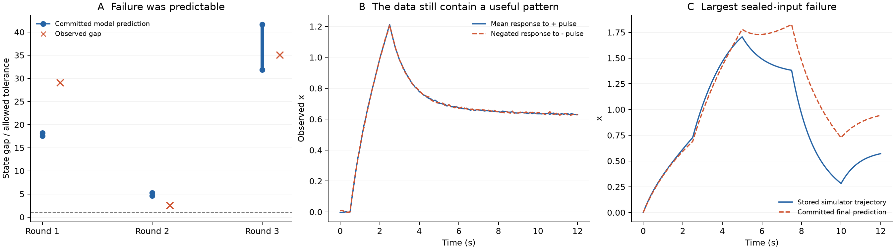

# 数据复盘：下一步应补上什么

复盘完成于 2026-11-01（Asia/Shanghai），对象是 2026-10-31 完成的 concept_discovery_v2。逐条读取九次 Luna 原文、五份假说、三轮预测提交与观测、全部拟合参数和六条封存预测，并检查执行代码。新增计算仅为现有数据的离线诊断，没有新 API 调用、没有新模拟器实验；原始运行文件哈希未变。

**首要问题是证据没有真正约束研究行动：已能预见的实验不满足条件仍被执行，已经被新变量部分解释的旧矛盾仍被重复分配，新概念的不同名字也没有经过可观测等价性检查。下一步应修复这三个环节，暂不扩充 agent 数量。**

## 1. 三组状态匹配失败，执行前其实已经能看见

原定三个成对实验都要求比较时刻两条轨迹的 x 差距不超过 0.04、输入相同。以下预测全部来自当时已经提交的 forecast_commit.json，不是事后重拟合。

| 轮次 | 两个目标假说各自预测的 x 差距 | 实际差距 | 允许差距 |
|---|---|---:|---:|
| 第一轮 | 0.727、0.703 | 1.162 | 0.04 |
| 第二轮 | 0.184、0.210 | 0.101 | 0.04 |
| 第三轮 | 1.274、1.666 | 1.403 | 0.04 |

三轮所有目标假说都预告了不满足条件。第一、三轮实际差距约为容差的 29 倍、35 倍。第二轮不匹配也不是难以预见的偶然偏差。

原因在执行链：design_validator 只检查输入幅度、时刻和字段；程序在计算预测后直接执行实验，没有把匹配失败返回设计器。Luna 自己也在 failure_of_design 中明确说过“正负输入可能把状态留在零点两侧”，但该字段仅被存档，没有改变行动。

**这是上一版调度器的遗漏。首先应把实验意图变成可执行约束，并在预测不支持该意图时退回方案。** 不能靠增加文字提醒代替这一步。

离线可行性计算进一步说明了工具能承担的部分：固定第二轮当时的三个已拟合模型，在四个预定输入阶段内用线性规划搜索，能找到模型预测差距约为 0.04 的成对输入，同时两个记忆模型对后续斜率效应的预测相差约 0.0601。原始斜率差统计量的观测噪声标准差约为 0.02。这仅是固定模型和固定阶段下的条件可行例子，不是显著性结论，也不保证真实系统匹配；该输入没有执行，且位于约束边缘。实际版本还要留出模型误差余量，并以真实观测确认条件。

## 2. “解释过的矛盾”还在触发新分支

每轮 collisions 都只按当前可见 x、u 找不同局部变化率，没有把已经提出的潜在状态或当前模型的预测误差作为新的检索依据。

第二轮最突出的一对观测，其变化率差为 0.171。用该轮开始前已有的输入历史模型解释后，剩余差约为 0.017；另外两对从 0.109、0.096 降为 0.00665、0.00064。可是分支仍被要求重点解释这些原始差异。第三轮前两条重点线索也从 0.182、0.171 降到约 0.014、0.016。

这里是同批观测上的条件导数诊断，不能据此宣布记忆模型已通过独立验证；该模型的整条轨迹误差依然很大。它说明的是：**“当前状态模型解释不了”与“当前记忆模型解释不了”不是同一个问题。** 调度器应把注意力转到新模型真正失败的预测、不能解释的残差或不满足的结构关系。

此外，第三轮四条 witness 只对应三种不同输入组合，有一条是重复输入观测带来的相近证据。按 witness 数量决定分支数量，会让重复测量扩大“待解决问题”的表观数量。

直接后果可在提案里看到：r1_b0 原样复用了 r0_b0 的公式和参数范围。五份提案只有四种数学结构。图谱目前主要记录历史，没有自动执行“合并重复解释、标记部分已解释、更新真正未解反例”。

## 3. 不同概念名字，可能只是同一预测模型的不同坐标

最终输入历史模型的形式为：

\[
\dot x=a+bx+cu+dz,\qquad \dot z=u-pz.
\]

令 \(r=d/c\)、\(q=p+r\)、\(k=b+q\)，在 \(c\ne0,k\ne0\) 时定义

\[
w=(x-cz)/k.
\]

直接代数代换得到：

\[
\dot x=a+(b+r)x+cu-rkw,\qquad
\dot w=x-qw+a/k.
\]

后一式看起来像“输出历史”，前一式看起来像“输入历史”，但它们对所有允许输入给出的 x 相同，只是隐藏坐标变了。当 a=0 时，隐藏方程中的常数项也消失。

用实际最终参数做这个变换，q≈0.238704、输出历史反馈系数≈0.123198。对九条已记录输入重放，两种写法的最大输出差只有 **6.66×10⁻¹⁶**；相同同步 Euler 离散化也保持这个线性坐标变换。

**这不表示本轮 r1_b0 和 r1_b1 两套已拟合参数完全相同。** 它们实际的极点和预测不同；r1_b1 也未包含上述隐藏常数项。结论是两类语义标签存在可观测等价的实现，不能仅凭隐藏变量被解释为“输入记忆”或“输出记忆”就断言发现了可区分的物理机制。

下一版应先做表达式去重、线性系统等价性判断，再对剩余候选设计区分实验。非线性情况下，少量探测输入上预测相近只能标为“当前证据下未区分”，不能当成等价证明。若希望赋予隐藏变量实体含义，还需要额外测量或可说明的结构假设。

## 4. 状态没有匹配，不等于数据没有信息

第三轮的两条输入是完全相反的同形脉冲。把三次重复正脉冲的响应取平均，再与负脉冲响应相加：

- 响应相加的 RMS 为 **0.00536**；
- 按已知观测噪声计算，该和的噪声标准差约 **0.00577**；
- 正脉冲响应本身 RMS 约 **0.709**。

这说明在这一个输入形状和幅度下，正负响应非常接近镜像。它不是全局对称性定律，但已经提供了一条具体结构约束。

当时提交的“平方输入记忆”模型预测正负响应之和 RMS 为 0.0605；“恢复”模型为 0.0876，都偏离该观测性质。输入历史模型的对应值也有 0.0557，不能选择性地只批评较差候选。当前拟合中的常数项和状态演化都会影响这种偏离。

因此这组实验可以用于检查模型的正负响应性质，即使不满足同状态比较的前提。下一版必须分别记录：主实验条件是否达成、完整轨迹预测是否正确、还有哪些结构性质得到信息。不能把一次未完成的匹配检验扩大成“这批数据没有用”，也不能把镜像现象直接变成未经更多干预考察的普遍规律。

## 5. 数值工具的分数也需要解释

### 重复输入没有按组留出

九条可见轨迹只包含七种不同的输入。新增六次实验中，正脉冲重复三次，因此只有四种不同的新增输入。原留一轨迹诊断会把同一输入的另一份带噪观测留在训练里；它衡量的不是完全未见输入的预测。

离线将同一输入的所有重复一起留出，并保持按九条观测加权，得到：

| 候选 | 原留一轨迹 NMSE | 按输入分组留出、同观测权重 NMSE |
|---|---:|---:|
| 当前状态 | 0.723 | 0.805 |
| 输入历史 | 0.402 | 0.482 |
| 输出历史 | 0.431 | 0.526 |
| 恢复 | 0.899 | 0.989 |
| 输入强度历史 | 1.196 | 1.292 |

排名未反转，但绝对误差更差。分组诊断在本地 Python 3.14 / NumPy 2.5.3 / SciPy 1.18.1 执行，是独立事后诊断，不替换服务器原结果。对于训练集完全不变的单例组，新旧结果最大差不超过 2.73×10⁻⁸，支持主要差异来自分组方式。输入按实际数值序列归组，不能让 JSON 中的 1 与 1.0 被误当成不同实验。

### 拟合目标与最终预测目标不一致

当前优化器最小化平滑后的局部变化率误差，最后却按整个自由运行轨迹计分。在输出历史候选上扫描其单个参数：

- 原优化器停在 p≈0.134；
- 扫描到 p=3 时，变化率误差更小，但训练轨迹 NMSE 升至约 4.40；
- 训练轨迹预测较好的扫描点在 p≈0.234。

这些都是训练内诊断，不用于挑选新的正式得分。它们说明单一起点和局部变化率拟合可能给模型比较带来额外偏差；一味把变化率拟合得更好，也可能使长期预测更差。下一版应考虑多起点、积分形式或直接轨迹拟合，并报告拟合不确定性。

此外，平滑与输入跳变窗口排除后，一秒负脉冲只留下 **一个非零输入样本**用于局部变化率拟合。该实验仍有其他零输入样本和完整轨迹信息，不能称为没有数据；但当前拟合方法几乎丢掉了它的受驱动阶段。实验设计与拟合器的可用样本要求应协调。

### 平均分隐藏了具体失败

六条封存轨迹平均 NMSE 约 0.0929，其中一条为 0.3832，占六条 NMSE 总和约 68.8%。最大误差发生在 8.5 秒：预测 x≈1.215，实际保存的无噪声轨迹为 x≈0.681。应追踪这种明确的预测失败，而非只向 agent 返回一个整体分数。

这些封存轨迹已在本轮被详细查看，后续可作为开发诊断，不能再冒充未见的确认数据。

## 6. 查看模拟器后可以知道什么——必须单独标记

事后读取模拟器定义可知，它包含非线性隐藏反馈，零输入下有约 ±0.613 的两个非零平衡点，零平衡点的一个特征值约为 +0.1027。这比“输入结束后记忆逐渐消失”的普通一阶松弛故事更复杂。

**这来自分析者对模拟器代码的访问，不是 Luna 从数据中发现的结果。** 下一版不能把正确方程、双稳态标签或这些参数塞回 agent 提示，再声称它自主发现。所有上面的预测匹配、镜像、分组诊断和输入可行性计算都不需要这部分隐藏知识。

## 下一步的优先顺序

1. **修复实验决策。** 把“保持什么相同、改变什么、期待哪种差异”编译成数字约束；预测不满足或区分度不足，就返回原因。执行后以实际观测确认条件，并保留其他可用信息。
2. **修复概念和反例记录。** 合并重复公式；标记等价、未区分和被反驳的区别；新分支针对当前模型的未解预测失败，而非永远回到最初当前状态模型的失败。
3. **修复拟合证据。** 按独立输入分组，减少变化率拟合与轨迹预测的脱节，提供逐段失败和对称性等诊断。拟合失败不应被解释为概念一定错误。
4. **再运行一条完整发现链。** 所有语言生成仍用 gpt-6-luna，不做人数消融。目标是完成一次有根据的解释合并、机制修订或适用边界缩小，并指出哪条观测改变了判断。

从现有数据出发，下一条有价值的问题是：**正负镜像关系在哪些输入范围内成立，而幅度缩放和不同历史是否遵循同一规律？** 这允许系统判断需要修改的是已有关系的非线性，还是必须新增状态变量。它比继续给“记忆”换名字更接近概念形成。

可争取的研究点是让系统决定“哪些不同解释实际上是一回事，哪些现象迫使现有概念分裂或新增变量，以及哪个实验能够决定这件事”。这与预测状态表示、系统辨识和反例引导合成有联系，是否有独立 novelty 仍需最近工作对照；本轮没有作出论文新颖性结论。

图 A：所有预提交预测已经预告状态匹配失败，虚线为允许上限。图 B：实测正负响应接近镜像。图 C：最差封存输入上的预测偏差。

详细数字：[DIAGNOSTICS.json](DIAGNOSTICS.json)；环境与反例重放核对：[REPLAY_CHECKS.json](REPLAY_CHECKS.json)；下一版实施顺序：[NEXT_PLAN.md](NEXT_PLAN.md)。本轮只产生离线复盘产物，没有修改已冻结实验源码、追加模型回答或运行新服务器任务。
